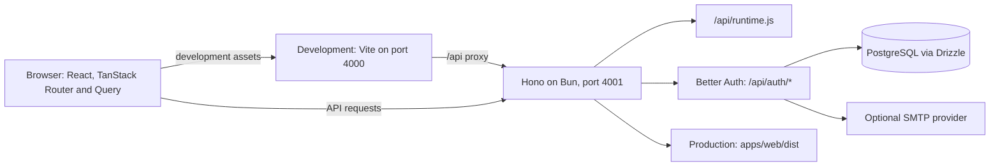

# Architecture

[Documentation index](README.md)

The repository contains a React single-page application and a Hono API. Development runs
Vite and Bun separately. Production bundles both applications and uses one Bun process to
serve the API and the web assets.

## System overview

The database currently stores authentication users, accounts, sessions, and verification
records. MinIO is supplied for local storage development; an optional S3 client is
available to future application routes.

## Workspace boundaries

| Location                                | Responsibility                                                                    |
| --------------------------------------- | --------------------------------------------------------------------------------- |
| [`apps/web`](../apps/web)               | React UI, file-based routes, providers, hooks, and browser clients                |
| [`apps/api`](../apps/api)               | HTTP routes, auth configuration, environment validation, SMTP, and static serving |
| [`packages/db`](../packages/db)         | Drizzle schema, PostgreSQL client factory, and committed SQL migrations           |
| [`packages/shared`](../packages/shared) | Browser-safe Zod schemas and shared types                                         |
| [`packages/config`](../packages/config) | Shared TypeScript configuration                                                   |
| [`tests`](../tests)                     | Database integration and production browser suites                                |
| [`scripts`](../scripts)                 | Production startup and offline migration drift checks                             |

pnpm links internal packages through `workspace:*`. Shared dependency versions live in
[`pnpm-workspace.yaml`](../pnpm-workspace.yaml); [`turbo.json`](../turbo.json) defines task
dependencies and build outputs.

Browser code can import `@repo/shared` and the `ApiRoutes` **type** from `@repo/api/types`.
Keep database connections, secrets, and Bun-only modules in server packages. The frontend
alias `@/` resolves to `apps/web/src`; it is configured in Vite and TypeScript.

## Frontend

[`main.tsx`](../apps/web/src/main.tsx) mounts the TanStack Router, TanStack Query, and Nuqs
providers. Route files live in `apps/web/src/routes`, while feature UI lives in
`apps/web/src/features`. The router plugin generates `routeTree.gen.ts` from route files.

Tailwind CSS v4 styles and theme tokens live in
[`index.css`](../apps/web/src/index.css). Reusable UI components live in
`apps/web/src/components/ui`. The starter includes a landing page and not-found recovery;
authentication screens and application-specific workflows need to be built by consumers.

[`lib/api.ts`](../apps/web/src/lib/api.ts) creates a Hono RPC client with session credentials
enabled. [`lib/auth.ts`](../apps/web/src/lib/auth.ts) exposes the Better Auth React client.
Both use the configured public API URL.

## Runtime configuration

[`index.html`](../apps/web/index.html) loads `/api/runtime.js` before the frontend module.
The API returns JavaScript assigning `window.__env`, with `Cache-Control: no-store`.
Only two explicitly selected values are exposed: `VITE_APP_URL` and `VITE_API_URL`.

[`env.ts`](../apps/web/src/env.ts) resolves each browser setting in this order:

1. The value in `window.__env`.
2. The Vite build-time value in `import.meta.env`.
3. The browser's current origin.

This lets the same production bundle use different public URLs at deployment time. Adding
a new `VITE_*` variable does not automatically expose it through the runtime endpoint;
update its allowlist and browser types deliberately. Server credentials stay in the
validated server environment defined by [`env-config.ts`](../apps/api/env-config.ts).

## Requests and authentication

[`createApp`](../apps/api/app.ts) accepts the public environment and an auth interface,
so HTTP tests can exercise routes without starting a server or connecting to PostgreSQL.
[`index.ts`](../apps/api/index.ts) supplies the real database, Better Auth instance, and
mailer for the running server.

Each request passes through request ID, structured logging, secure headers, and credentialed
CORS middleware. The allowed origins come from the public app and API URLs. Auth requests
are delegated to Better Auth before application routes and JSON API 404 handling.

The session middleware reads the request headers through Better Auth and puts the verified
user in Hono context. `/api/me` returns that user with `Cache-Control: no-store`.
Authentication uses PostgreSQL-backed sessions and email/password accounts. Origin and CSRF
checks are enabled. Auth rate limiting uses process-local memory with a configured limit
of 20 requests per 60 seconds; deployment topology and client IP handling matter when
scaling this behavior.

SMTP enables verification emails on signup and password reset callbacks when host, port,
and sender are configured. Verification is not configured as a prerequisite for signing in.
The optional [`storage.ts`](../apps/api/storage.ts) exports a Bun S3 client when all storage
settings are present; application upload routes and authorization policies must be added
before using it for user uploads.

## Database and migrations

[`createDb`](../packages/db/index.ts) builds a Drizzle client over `postgres`.
[`schema/index.ts`](../packages/db/schema/index.ts) defines the auth tables and cascading
account/session foreign keys. Versioned SQL and Drizzle metadata live together in
[`packages/db/drizzle`](../packages/db/drizzle).

Generate and review migrations alongside schema changes. Deployment applies them as a
separate release step before starting the new server. Startup does not migrate the database.
See [Contributing](CONTRIBUTING.md#database-changes) for the development workflow and
[Deployment](DEPLOYMENT.md#database-release-step) for production considerations.

## Production serving and observability

`pnpm build` produces the Vite app in `apps/web/dist` and the bundled Bun entry point in
`apps/api/dist/index.js`. `pnpm start` resolves paths from the repository root and forces
production mode. The server registers API handlers first, then static files, then the SPA
index fallback. Unknown `/api` paths keep their JSON 404 response; frontend deep links load
the SPA and are resolved by TanStack Router.

Request logs are JSON records containing the request ID, method, route pattern, status, and
duration. Route patterns avoid writing auth tokens or query values into access logs.
Unexpected errors are logged server-side and return a generic error with a request ID.
Logs use the console; external error tracking and distributed tracing require additional
integration. See [API](API.md) for response contracts and [Testing](TESTING.md) for coverage.
